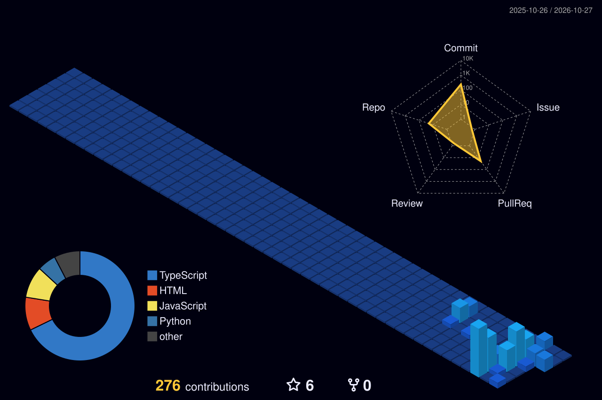

<!-- ======================= HERO ======================= -->

  

  

  
  
  
  
  
  

  
  
  
  

<!-- ======================= FLOATING ======================= -->

  

<!-- ======================= DASHBOARD (LIVE) ======================= -->

  
   
  🟢 <i>Dashboard live: jam WIB & statistik diperbarui otomatis oleh GitHub Actions</i>

🇬🇧 <b>English summary</b> (tap to expand)

 

**Hi, I'm AXRYZURE** 👋 — a web & bot developer from Indonesia 🇮🇩

- **Web apps** with React, TypeScript, Vite and Tailwind CSS (8 live demos)
- **Bots** — modular WhatsApp framework [`axybot`](https://github.com/superrrkyy/axybot)
- **REST APIs** with Flask, Node.js, API-key auth and SQLite
- **Guides in Indonesian** — Termux/proot-distro, coding basics for beginners

📍 Portfolio: https://superrrkyy.github.io/ · 📫 iranassalam@gmail.com

  

<!-- ======================= TENTANG ======================= -->

<h2 align="center">👋 Tentang Saya</h2>

  

  <i>Web &amp; Bot Developer dari Indonesia yang suka membangun hal-hal berguna dan berbagi ilmu.</i>

<table align="center" width="100%">
  <tr>
    <td align="center" valign="top" width="25%">
      <h3>🌐 Web Modern</h3>
      Website responsif dengan <b>React + TypeScript</b> dan animasi yang halus.
    </td>
    <td align="center" valign="top" width="25%">
      <h3>🤖 Bot & Otomasi</h3>
      Bot <b>WhatsApp & Telegram</b> dengan framework modular <code>axybot</code>.
    </td>
    <td align="center" valign="top" width="25%">
      <h3>🔌 REST API</h3>
      API dengan <b>Flask & Node.js</b>, autentikasi API key, dan SQLite.
    </td>
    <td align="center" valign="top" width="25%">
      <h3>📚 Panduan</h3>
      Menulis <b>panduan coding</b> berbahasa Indonesia untuk pemula.
    </td>
  </tr>
</table>

  

  

<!-- ======================= TECH STACK ======================= -->

<h2 align="center">🛠️ Tech Stack</h2>

<table align="center">
  <tr>
    <td align="center"><b>FRONTEND</b></td>
  </tr>
  <tr>
    <td align="center">
      
    </td>
  </tr>
  <tr>
    <td align="center"><b>BACKEND • DATA • TOOLS</b></td>
  </tr>
  <tr>
    <td align="center">
      
    </td>
  </tr>
  <tr>
    <td align="center">
      
    </td>
  </tr>
</table>

  

  

<!-- ======================= PROYEK UNGGULAN ======================= -->

<h2 align="center">🚀 Proyek Unggulan</h2>

<table width="100%">
  <tr>
    <td width="50%" valign="top">
      
    </td>
    <td width="50%" valign="top">
      
    </td>
  </tr>
  <tr>
    <td width="50%" valign="top">
      
    </td>
    <td width="50%" valign="top">
      
    </td>
  </tr>
  <tr>
    <td width="50%" valign="top">
      
    </td>
    <td width="50%" align="center" valign="middle">
      
    </td>
  </tr>
</table>

<b>📚 Panduan & Edukasi</b> (ketuk untuk membuka)

 

| | Panduan | Isi |
|:-:|:--|:--|
| 📱 | [**termux-linux-distro-guide**](https://github.com/superrrkyy/termux-linux-distro-guide) | Linux (Ubuntu, Debian, Arch, Kali) di Android |
| 💡 | [**belajar-coding-dasar**](https://github.com/superrrkyy/belajar-coding-dasar) | Dasar coding & jenis error |

  

<!-- ======================= WEBSITE LIVE ======================= -->

<h2 align="center">🌐 Website Live</h2>

<table align="center">
  <tr>
    <td align="center"></td>
    <td align="center"></td>
  </tr>
  <tr>
    <td align="center"></td>
    <td align="center"></td>
  </tr>
  <tr>
    <td align="center"></td>
    <td align="center"></td>
  </tr>
  <tr>
    <td align="center"></td>
    <td align="center"></td>
  </tr>
</table>

  

<!-- ======================= STATISTIK ======================= -->

<h2 align="center">📊 Statistik GitHub</h2>

<table width="100%">
  <tr>
    <td width="50%" valign="top" align="center">
      
    </td>
    <td width="50%" valign="top" align="center">
      
    </td>
  </tr>
  <tr>
    <td colspan="2" align="center">
      
    </td>
  </tr>
</table>

  

<!-- ======================= KONTRIBUSI ======================= -->
<h2 align="center">🧊 Kontribusi 3D</h2>

  

<h2 align="center">🐍 Kontribusi Animasi</h2>

  <picture>
    <source media="(prefers-color-scheme: dark)" srcset="https://raw.githubusercontent.com/superrrkyy/superrrkyy/output/snake-dark.svg" />
    <source media="(prefers-color-scheme: light)" srcset="https://raw.githubusercontent.com/superrrkyy/superrrkyy/output/snake.svg" />
    
  </picture>

  

<!-- ======================= KONTAK ======================= -->

<h2 align="center">🤝 Mari Terhubung</h2>

  <i>Punya ide proyek, ingin kolaborasi, atau sekadar menyapa? Silakan hubungi saya!</i>

  
  
  
  

<!-- ======================= FOOTER ======================= -->

  

  

  

  ⭐ Kalau suka dengan proyek-proyekku, jangan lupa beri bintang! • <b>AXRYZURE</b> © 2026 • <a href="./LICENSE">MIT License</a>

